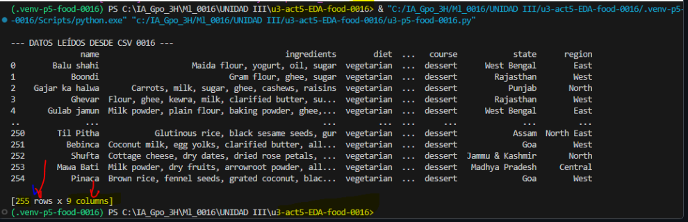
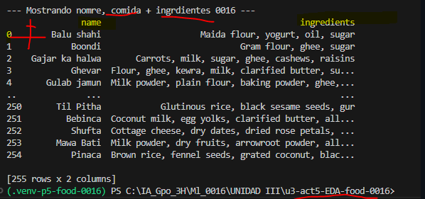
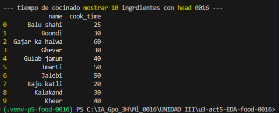
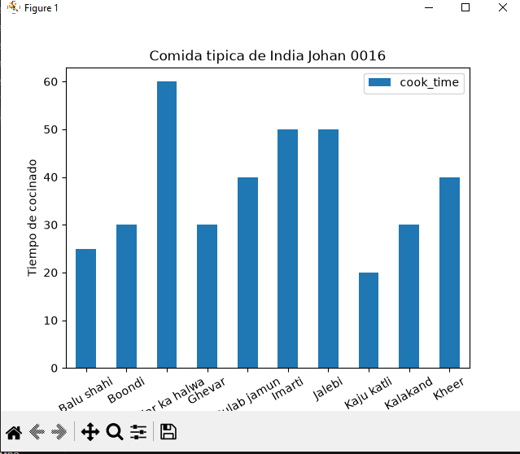
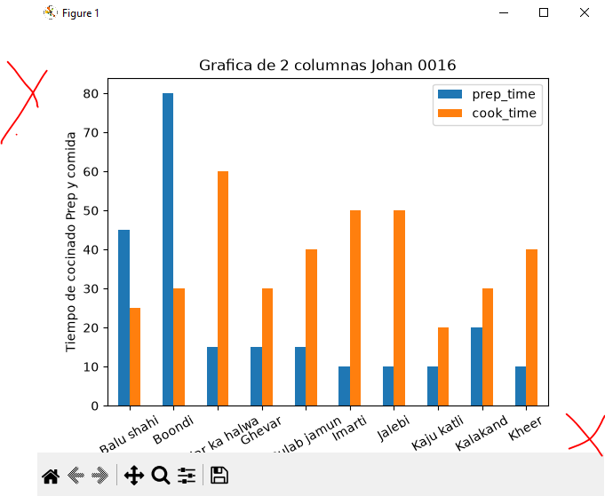
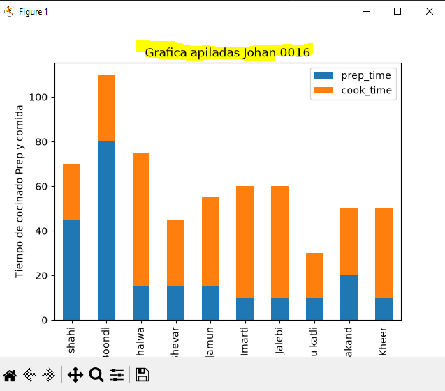

## Analisis exploratorio de datos
## Comida del pais india
## Johan Paulo '0016
## +-+-+- Importando datos del archivo csv comida india

## Mostrar nombre de comida

## Tiempo de cocinado mostrar 10 registros con head

## Creacion de graficas

## Grafica de varias columnas

## Grafica apiladas
